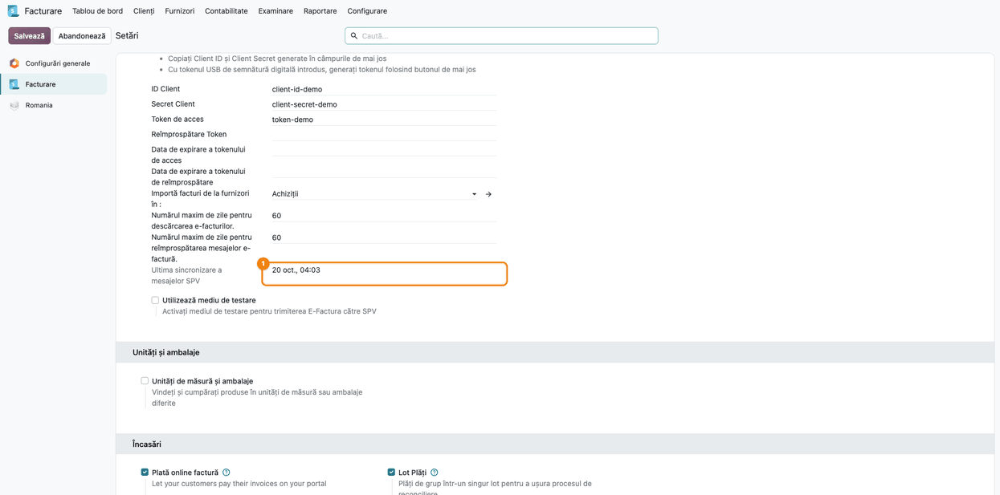
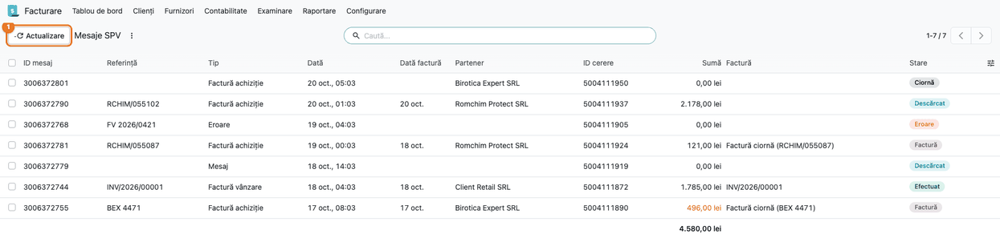
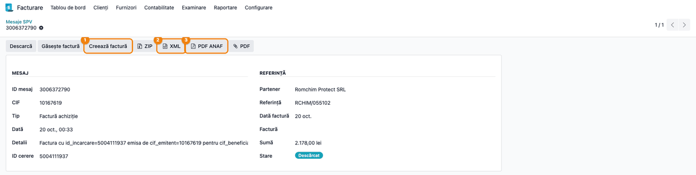
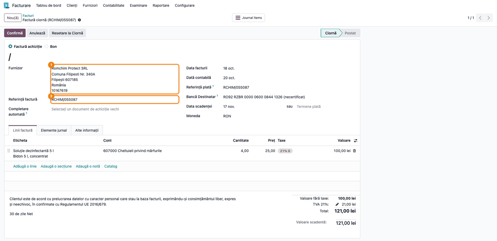
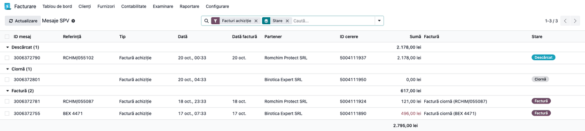
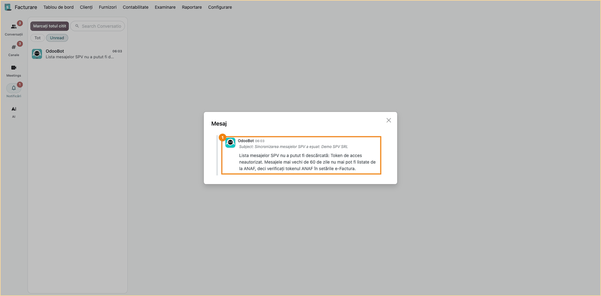

# Fișă Modul: Mesaje SPV și facturi primite prin e-Factura

**Modul:** `l10n_ro_message_spv`
**Utilizator principal:** Contabil furnizori, Contabil e-Factura / responsabil SPV
**Prioritate:** 🔴 Ridicată (orice factură B2B de la un furnizor din România trece prin SPV, iar
mesajele nu mai pot fi listate din SPV după 60 de zile)

---

## 1. Scop business

Facturile primite de la furnizorii din România ajung în Spațiul Privat Virtual (SPV) al firmei, ca
fișiere XML semnate de Ministerul Finanțelor. Modulul aduce în Odoo **registrul mesajelor SPV**: le
listează zilnic pe toate (facturi primite, facturi trimise, erori, mesaje), descarcă arhiva ZIP
semnată a fiecăruia, creează factura de furnizor în Ciornă direct din XML și leagă mesajul de factura
din contabilitate. Contabilul vede într-un singur ecran ce a venit din SPV, ce s-a descărcat, ce are
deja factură și ce a căzut în eroare. Dacă ANAF refuză sincronizarea, contabilii-șefi și
administratorii primesc o notificare (în Discuss sau pe email).

## 2. Bază legală și context

- **OUG 120/2021** privind sistemul național RO e-Factura, cu modificările ulterioare, care au extins
  din 2024 obligația e-Factura la tranzacțiile B2B între persoane impozabile stabilite în România:
  facturile de la furnizorii din România se primesc prin sistemul RO e-Factura, iar XML-ul cu
  sigiliul electronic al Ministerului Finanțelor este documentul original.
- **Arhivarea** documentelor justificative rămâne în sarcina firmei, pe termenele din Legea
  contabilității nr. 82/1991. SPV-ul nu este o arhivă: mesajele pot fi listate și descărcate de la
  ANAF doar pentru ultimele **60 de zile**.

Context operațional: dacă sincronizarea cu ANAF se oprește (token expirat, drepturi SPV lipsă) și
nimeni nu observă, după 60 de zile mesajele nu mai pot fi listate din Odoo. De aceea modulul trimite
o notificare la prima eroare și păstrează în setări data ultimei sincronizări reușite.

## 3. Utilizatori și roluri

- **Contabil furnizori** — verifică lista de mesaje, creează facturile de furnizor din XML și le
  completează (produse, conturi, taxe) înainte de confirmare.
- **Contabil-șef** (drept de administrator la Contabilitate) — primește notificările de eroare și
  rezolvă mesajele în eroare.
- **Administrator** (drept **Administrare: Setări**) — configurează conexiunea cu ANAF (modulul
  standard `l10n_ro_edi`), regenerează tokenul ANAF și primește și el notificările de eroare. Doar
  acest rol vede **Configurare → Setări**.

Roluri recomandate pentru testare (denumirile din formularul utilizatorului diferă între ediții, de
aceea sunt date și grupurile tehnice):
- utilizator contabil (`account.group_account_user`; în Enterprise **Bookkeeper**, în Community
  opțiunea **Afișați toate funcțiile din contabilitate**): citește, descarcă și creează facturi;
- utilizator doar citire (`account.group_account_readonly`; în Enterprise **Read-only**): vede
  mesajele și descarcă fișierele lor, dar nu are butoanele **Actualizare**, **Descarcă**, **Găsește
  factură** și **Creează factură**. Un utilizator doar cu drept de **Facturare**, fără funcțiile de
  contabilitate, nu are meniul **Contabilitate**, deci nici meniul **SPV**;
- contabil-șef (`account.group_account_manager`) și administrator (**Administrare: Setări**):
  primesc notificarea de eroare (Pasul 6);
- toți utilizatorii de mai sus au nevoie și de grupul **Meniuri RO** (`l10n_ro_config.group_ro_menus`),
  altfel meniul **SPV** nu apare.

## 4. Conturi și date implicate

Modulul nu generează note contabile proprii: creează factura de furnizor în **Ciornă**, iar nota
contabilă apare la confirmarea facturii, prin contabilitatea standard.

| Cont | Rol |
|---|---|
| 401 „Furnizori” | datoria față de furnizor |
| 4426 „TVA deductibilă” / 4428 „TVA neexigibilă” | TVA-ul facturii, după **taxa Odoo** aleasă pe linie la import |
| 4427 „TVA colectată” | doar la taxare inversă internă (autolichidare) |
| 408 „Furnizori - facturi nesosite” | când recepția (NIR) s-a făcut înaintea facturii |
| 3xx / 6xx | stocuri sau cheltuieli: din produs sau categoria lui; fără produs, din contul implicit al jurnalului de achiziții (607000 în planul RO) |

Date minime pentru demo:
- companie românească, cu CIF și planul de conturi RO;
- conexiunea e-Factura configurată (token ANAF generat) sau, pentru capturi, mesaje simulate;
- un furnizor român cu CIF, sau lăsat să fie creat automat din XML;
- un jurnal de cumpărări;
- un contabil-șef sau un administrator, pentru notificări.

## 5. Configurare inițială

> Căile din fișă pornesc din aplicația **Facturare**, ca în capturi. Cu aplicația **Contabilitate**
> instalată, primul nivel al meniului se numește **Contabilitate**; restul căii rămâne la fel.

1. Instalați modulul `l10n_ro_message_spv` (dependențe: `l10n_ro_edi`, `account_edi`,
   `l10n_ro_config`).
2. În **Facturare → Configurare → Setări**, secțiunea **E-Factura România**, configurați conexiunea
   cu ANAF (**ID Client**, **Secret Client**) și apăsați **Generare token** cu certificatul digital
   conectat.
3. În aceeași secțiune completați **Numărul maxim de zile pentru descărcarea e-facturilor** (implicit
   60: câte zile în urmă listează acțiunea programată zilnică) și **Numărul maxim de zile pentru
   reîmprospătarea mesajelor e-factură** (implicit 60: câte zile în urmă listează butonul
   **Actualizare**).
4. Atribuiți utilizatorilor grupul **Meniuri RO**, ca să vadă meniul **SPV**.
5. Cu modul dezvoltator activ, verificați în **Setări → Tehnic → Automatizare → Acțiuni
   programate** că sunt active acțiunile **Facturare electronică România: Descarcă mesaj SPV**
   (listează mesajele) și **Facturare electronică România: Descarcă mesaj ZIP SPV** (descarcă
   arhivele în loturi de câte 5, reluate automat până se descarcă toate).
6. Verificați că destinatarii notificărilor (contabilii-șefi și administratorii companiei) au în
   **Preferințe** opțiunea **Notificare: În Odoo**, dacă vreți să vadă eroarea în
   Discuss. Cu opțiunea implicită, **Prin e-mailuri**, notificarea vine doar pe email.

## 6. Flux de utilizare

### Pasul 1 — Verificarea setărilor și a ultimei sincronizări

Accesați **Facturare → Configurare → Setări**, secțiunea **E-Factura România**. Pe lângă cele două
câmpuri cu numărul de zile, găsiți pe ecran **Ultima sincronizare a mesajelor SPV**: data și ora
ultimei listări reușite a mesajelor de la ANAF, pentru compania curentă.

Verificați că data este de azi sau de ieri: acțiunea programată rulează zilnic. O dată mai veche de
câteva zile înseamnă că sincronizarea s-a oprit (vezi Pasul 6). Bifa **Utilizează mediu de
testare** trebuie să fie debifată în producție.



### Pasul 2 — Lista mesajelor SPV

Accesați **Facturare → Contabilitate → SPV → Mesaje SPV**. Lista arată toate mesajele primite din
SPV, cele mai noi primele. Găsiți pe ecran:

- coloana **Tip** — **Factură achiziție** (factură primită), **Factură vânzare** (factură trimisă),
  **Eroare** (factură trimisă și respinsă de ANAF), **Mesaj**;
- coloana **Partener** — furnizorul sau clientul, identificat după CIF;
- coloanele **Referință** (numărul facturii din XML), **Dată factură** și **Sumă**;
- coloana **Factură** — factura din Odoo legată de mesaj;
- coloana **Stare** — **Ciornă** (listat, nedescărcat), **Descărcat** (arhiva ZIP e în Odoo),
  **Factură** (factura legată e în Ciornă), **Efectuat** (factura legată e confirmată), **Eroare**
  (cu roșu).

Verificați: niciun mesaj de tip **Factură achiziție** nu stă în **Ciornă** mai mult de o zi (arhiva
se descarcă automat); mesajele în **Eroare** au textul erorii pe formular. O **Sumă** afișată cu roșu
înseamnă că totalul din XML diferă de totalul facturii legate.

Butonul **Actualizare** din antetul listei listează imediat mesajele de la ANAF pentru compania
curentă, fără să mai aștepte acțiunea programată.

> Mesajele de tip **Eroare** se șterg și se recreează la fiecare sincronizare. Pe un astfel de mesaj,
> **Găsește factură** leagă factura de vânzare după indexul de încărcare, o marchează ca respinsă de
> ANAF și șterge XML-ul și PDF-ul generate pentru ea, ca factura să poată fi corectată și retrimisă.



### Pasul 3 — Mesajul unei facturi primite

Deschideți un mesaj de tip **Factură achiziție** în starea **Descărcat**. Formularul are două
grupuri:

- **Mesaj** — ID-ul mesajului, CIF-ul emitentului, tipul, data, detaliile de la ANAF și **ID cerere**
  (indexul de încărcare);
- **Referință** — partenerul, numărul și data facturii, factura legată, suma și starea.

Un al treilea grup, **Erori și informații**, apare doar când mesajul are o eroare sau un text de
informare de la ANAF.

Din antet descărcați documentele: **ZIP** (arhiva semnată de la ANAF), **XML** (factura),
**PDF ANAF** (vizualizarea generată de serviciul ANAF) și **PDF** (PDF-ul atașat de furnizor în XML,
dacă există).



### Pasul 4 — Crearea facturii de furnizor din XML

Pe mesajul descărcat, apăsați **Creează factură** (sau selectați mai multe mesaje în listă și folosiți
același buton din antet). Modulul:

1. caută întâi o factură existentă pentru mesaj (butonul **Găsește factură** face doar această
   căutare): după ID-ul mesajului, indexul de încărcare sau referința furnizorului;
2. dacă nu găsește, creează factura de furnizor în **Ciornă** din XML: furnizorul după CIF, liniile,
   taxele, referința și data facturii; produsul se caută întâi după codul furnizorului;
3. dacă există deja o factură cu aceeași referință la același furnizor (introdusă manual), îi mută
   XML-ul și o leagă de mesaj, în loc să creeze un duplicat.

Mesajul trece în starea **Factură**. Factura se deschide din câmpul **Factură** al mesajului sau, din
listă, cu butonul **Arată factură**.

Înainte de **Confirmă**, verificați pe fiecare linie:

- **Contul** — fără produs găsit, linia primește contul implicit al jurnalului de achiziții (în
  captură, 607000 „Cheltuieli privind mărfurile”, corect la achiziție doar în inventarul
  intermitent). Alegeți produsul sau corectați contul după natura achiziției: mărfuri cu stoc → 371
  (prin produsul stocabil), materiale consumabile → 6028 sau 302x, servicii → 6xx-ul serviciului
  (ex. 628, 611). În exemplul din captură, soluția dezinfectantă pentru uz propriu merge pe 6028;
- **Taxa** — importul alege taxa Odoo după cota din XML. Pentru un furnizor cu TVA la încasare sau
  pentru taxare inversă alegeți taxa corespunzătoare (vezi monografia de mai jos).

Dacă schimbați produsul pe o linie venită din XML, descrierea și prețul unitar primite de la furnizor
rămân neschimbate. Coloana opțională **Cod furnizor** arată codul de articol din XML; la **Confirmă**,
codul se salvează în lista de furnizori a produsului, iar la următoarea factură produsul este găsit
automat.



### Pasul 5 — Verificarea asocierilor

Înapoi în **Mesaje SPV**, aplicați filtrul **Facturi achiziție** și grupați după **Stare**. Găsiți pe
ecran:

- grupurile **Factură** și **Efectuat** — mesajele care au factură în Odoo; coloana **Factură** arată
  numărul ei sau, la ciorne, „Factură ciornă (referința furnizorului)”;
- grupul **Descărcat** — facturi primite care încă nu au factură în contabilitate;
- grupul **Ciornă** — mesaje listate, încă nedescărcate (se descarcă la rularea următoare);
- **Sumă** cu roșu — factura legată are alt total decât XML-ul.

Verificați: fiecare factură de furnizor primită în perioadă are mesajul în grupul **Factură** sau
**Efectuat**, iar nicio sumă nu e roșie. Confirmarea facturii nu schimbă singură starea mesajului:
apăsați **Găsește factură** pe mesajele selectate ca starea să treacă în **Efectuat** și suma
facturii să se actualizeze. Pentru mesajele din **Descărcat**, apăsați **Găsește factură** (dacă
factura a fost introdusă manual) sau **Creează factură**.



### Pasul 6 — Notificarea când sincronizarea cu ANAF eșuează

Dacă ANAF refuză listarea (token expirat, lipsa dreptului SPV pe CIF, limita de cereri atinsă):

- acțiunea programată nu se oprește pentru celelalte companii: doar compania afectată rămâne
  nesincronizată;
- mesajele deja existente în Odoo nu se șterg;
- contabilii-șefi și administratorii companiei primesc o notificare de la OdooBot, cu subiectul
  **Sincronizarea mesajelor SPV a eșuat: <companie>** și motivul primit de la ANAF. Notificarea
  apare în **Discuss → Casuța poștală** (primul element din Discuss) pentru cei cu **Notificare:
  În Odoo** și pe email pentru cei cu **Prin e-mailuri** (opțiunea implicită). Notificarea nu
  e legată de o înregistrare: la click se deschide într-un dialog, cu textul complet.

Notificarea se trimite o singură dată pentru aceeași eroare, nu la fiecare rulare. O eroare diferită
produce o notificare nouă. Data **Ultima sincronizare a mesajelor SPV** din setări rămâne cea a
ultimei listări reușite.

Remediați cauza (vezi secțiunea 9; regenerarea tokenului cere drept **Administrare: Setări**), apoi
apăsați **Actualizare** în **Mesaje SPV**, pe compania afectată. Dacă problema persistă, butonul
afișează eroarea direct pe ecran.



### Note de monografie și raportare

Modulul nu înregistrează note contabile. La confirmarea facturii de furnizor create din XML, Odoo
generează nota standard. Contul de TVA vine din taxa Odoo de pe linie, nu din XML:

| Operațiune | Debit | Credit |
|---|---|---|
| Factură de achiziție, fără recepție anterioară | 371 „Mărfuri” / 6xx | 401 „Furnizori” |
| TVA deductibilă (regim normal) | 4426 „TVA deductibilă” | 401 „Furnizori” |
| TVA de la un furnizor cu TVA la încasare | 4428 „TVA neexigibilă” | 401 „Furnizori” |
| ↳ la plata facturii | 4426 „TVA deductibilă” | 4428 „TVA neexigibilă” |
| Taxare inversă internă (autolichidare) | 4426 „TVA deductibilă” | 4427 „TVA colectată” |
| Factură după recepție (NIR anterior pe 408) | 408 „Furnizori - facturi nesosite” | 401 „Furnizori” |

Exemplu, pe factura din captura 04 după corectarea contului (consumabil pentru uz propriu):
Dr 6028 100,00 + Dr 4426 21,00 = Cr 401 121,00 lei.

Contul de stoc sau de cheltuială vine din produs (sau categoria lui); fără produs, din contul implicit
al jurnalului de achiziții. Verificați contul și taxa fiecărei linii înainte de **Confirmă**.

## 7. Legături cu alte module / declarații

| Modul | Rol |
|---|---|
| `l10n_ro_edi` (standard) | conexiunea OAuth cu ANAF, tokenul, trimiterea facturilor de vânzare și importul standard al facturilor primite |
| `account_edi` | importul UBL/CIUS-RO al XML-ului în factura de furnizor |
| `l10n_ro_config` | grupul **Meniuri RO**, care afișează meniul **SPV** |
| `l10n_ro_message_spv_purchase` | asocierea facturii primite cu comanda de achiziție |
| `l10n_ro_message_spv_self_billing` | numerotarea autofacturilor după numărul din mesaj |

Modulul standard `l10n_ro_edi` are propria acțiune programată, **E-Factura: Sincronizare cu ANAF**,
care poate importa singură facturile primite, în Ciornă, în jurnalul din câmpul **Importă facturi de
la furnizori în** (secțiunea **E-Factura România** din setări). Facturile create astfel au indexul de
încărcare, deci **Găsește factură** și **Creează factură** le leagă de mesaj fără să creeze
duplicate. Tot `l10n_ro_edi` are acțiunea **E-Factura: Reîmprospătare token de acces**, care
reînnoiește tokenul cât timp tokenul de reîmprospătare este valid.

**Ce e automat:**
- listarea zilnică a mesajelor din SPV, pentru fiecare companie cu token;
- descărcarea arhivelor ZIP (în loturi de câte 5, reluate până se descarcă toate; după 3 eșecuri
  pe zi, mesajul se reia a doua zi);
- notificarea contabililor-șefi și a administratorilor la o eroare nouă de sincronizare;
- data ultimei sincronizări reușite, pe companie.

**Ce rămâne manual:**
- crearea facturilor de furnizor din mesaje (**Creează factură**) și verificarea conturilor și
  taxelor;
- confirmarea facturilor;
- reînnoirea tokenului ANAF când a expirat și tokenul de reîmprospătare, și rezolvarea erorilor de
  sincronizare.

## 8. Verificări pentru consultant

- [ ] În setări, **Ultima sincronizare a mesajelor SPV** este de azi sau de ieri.
- [ ] **Actualizare** în **Mesaje SPV** aduce mesajele noi fără eroare.
- [ ] Niciun mesaj **Factură achiziție** nu stă în **Ciornă** de mai mult de o zi.
- [ ] **Creează factură** pe un mesaj descărcat produce o factură în **Ciornă**, cu furnizorul,
      referința, data și totalul din XML.
- [ ] Pe o factură introdusă manual cu aceeași referință, **Creează factură** leagă factura existentă,
      fără duplicat.
- [ ] Pe factura creată, contul și taxa fiecărei linii sunt verificate înainte de **Confirmă**.
- [ ] După confirmarea facturilor, **Găsește factură** trece mesajele în **Efectuat**.
- [ ] Butoanele **ZIP**, **XML**, **PDF ANAF** descarcă fișierele mesajului.
- [ ] Cu un token invalid, acțiunea programată nu cade, mesajele existente rămân, iar contabilul-șef
      primește **o singură** notificare (în Discuss sau pe email, după preferința lui), chiar dacă
      acțiunea rulează de mai multe ori.
- [ ] Într-o bază cu mai multe companii, eroarea unei companii nu oprește sincronizarea celorlalte.

## 9. Mesaje de eroare frecvente

Mesajele de mai jos apar în notificarea de eroare sau, la **Actualizare**, direct pe ecran.

| Mesaj | Cauză | Remediere |
|---|---|---|
| Lista mesajelor SPV nu a putut fi descărcată: Token de acces neautorizat. | tokenul ANAF a expirat sau a fost revocat | în **Facturare → Configurare → Setări**, secțiunea **E-Factura România**, ștergeți **Token de acces**, salvați, apoi apăsați **Generare token** cu certificatul digital conectat |
| Lista mesajelor SPV nu a putut fi descărcată: Token de acces refuzat. | tokenul nu are acces la serviciul e-Factura | regenerați tokenul ca mai sus, cu un certificat înrolat în SPV pentru CIF-ul companiei |
| Lista mesajelor SPV nu a putut fi descărcată: urmat de textul ANAF despre lipsa dreptului de interogare pe CIF | certificatul folosit la token nu are drept SPV pe CIF-ul companiei | înrolați certificatul pentru CIF în SPV, apoi regenerați tokenul ca mai sus |
| Lista mesajelor SPV nu a putut fi descărcată: Ați atins limita de solicitări. Vă rugăm să încercați din nou mai târziu. | limita zilnică de interogări ANAF | se reia automat la următoarea rulare; nu apăsați repetat **Actualizare** |
| Lista mesajelor SPV nu a putut fi descărcată: Există o problemă cu SPV. Vă rugăm să încercați din nou mai târziu. / … Timeout la trimiterea către SPV… | serviciul ANAF e indisponibil (mentenanță) sau nu a răspuns la timp | se reia automat la rularea următoare; dacă persistă câteva zile, verificați anunțurile ANAF |
| Lista mesajelor SPV nu a putut fi interpretată. | răspuns ANAF neașteptat (serviciu indisponibil) | reîncercați mai târziu |
| Nu s-a găsit XML în ZIP-ul descărcat. (în câmpul **Eroare** al mesajului sau la butoanele **XML**, **PDF ANAF**) | arhiva descărcată nu conține factura | descărcați **ZIP**-ul, verificați conținutul și semnalați furnizorului sau ANAF; **Descarcă** nu redescarcă un mesaj care are deja arhiva |
| Mesaj în starea **Eroare** după descărcare | 3 eșecuri de descărcare în aceeași zi (limita ANAF de 10 descărcări pe mesaj) | se reia automat a doua zi sau manual cu **Descarcă** |

## 10. Capturi de ecran

Capturile sunt generate automat din `tests/test_screenshots.py`, cu mixinul `ScreenshotCase` din
`l10n_ro_doc_screenshots` (import defensiv: testul se sare dacă modulul lipsește), cu interfața în
română, pe planul de conturi RO. Stau în `static/description/`.

1. `01_setari_spv.png` — setările E-Factura: zilele de descărcare și ultima sincronizare SPV.
2. `02_lista_mesaje_spv.png` — lista **Mesaje SPV**, cu tipurile și stările mesajelor.
3. `03_mesaj_factura_primita.png` — formularul unui mesaj de factură primită, descărcat.
4. `04_factura_furnizor_creata.png` — factura de furnizor creată în Ciornă din XML.
5. `05_mesaje_grupate_stare.png` — facturile primite, grupate pe stare.
6. `06_notificare_eroare_sincronizare.png` — notificarea de eroare a sincronizării SPV, în Discuss.

Regenerare:

```bash
./odoo/odoo-bin -c odoo.conf -d <db> -i l10n_ro_message_spv,l10n_ro_doc_screenshots \
    --test-tags=fise_screenshots --stop-after-init
```

## 11. Observații pentru manual

- Insistați pe fereastra de 60 de zile a SPV: notificarea de eroare și data ultimei sincronizări din
  setări sunt semnalele de urmărit, nu lista de mesaje. Recomandați destinatarilor opțiunea
  **Notificare: În Odoo** sau o regulă de email care să nu ascundă notificarea.
- Explicați diferența dintre **Găsește factură** (doar asociază și actualizează starea) și **Creează
  factură** (asociază sau creează).
- Contul și taxa vin din Odoo (produs, jurnal, taxa aleasă după cotă), nu din XML: verificarea
  liniilor înainte de confirmare rămâne responsabilitatea contabilului, mai ales la furnizorii cu TVA
  la încasare și la taxarea inversă.
- Descrierea și prețul primite în XML rămân pe linie chiar dacă schimbați produsul.
- Meniul **SPV** apare doar utilizatorilor cu grupul **Meniuri RO** și cu acces la meniul
  **Contabilitate**.
